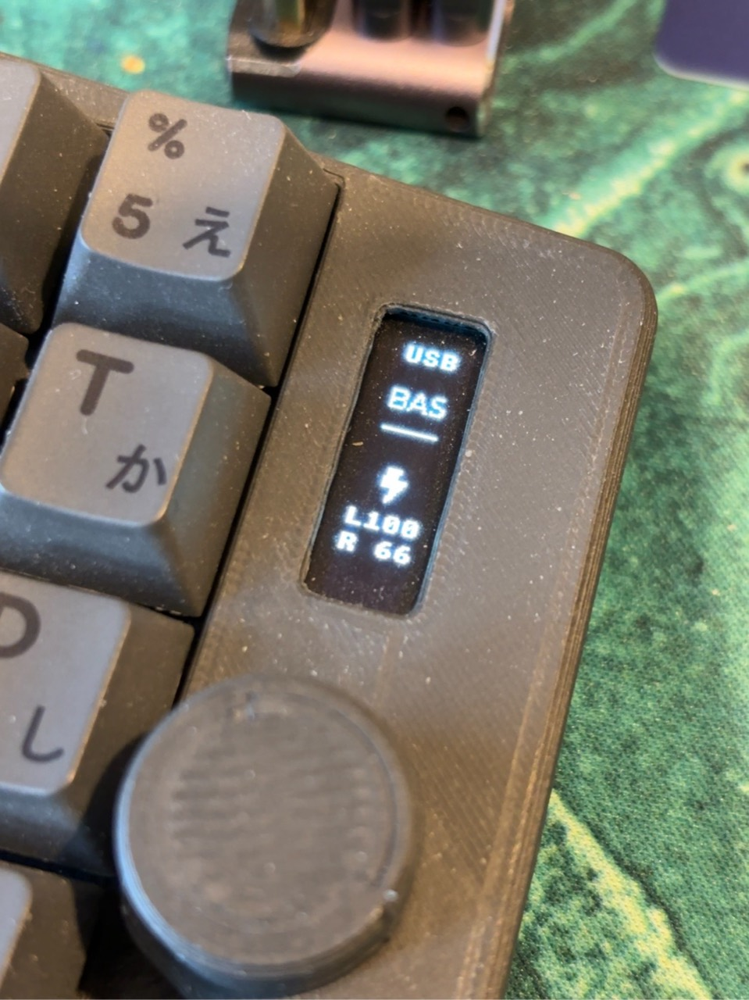

# Takmak OLED v0.1.0

[Download UF2](https://github.com/seniorsoftwarevlogger/takmak/releases/download/oled-v0.1.0/takmak-oled-left-central-v0.1.0.uf2) · [Release and SHA-256](https://github.com/seniorsoftwarevlogger/takmak/releases/tag/oled-v0.1.0) · [Русский](oled.md)

An update for the **left central half** of Takmak using a SuperMini nRF52840 /
nice!nano v2 controller and a 0.91-inch SSD1306 128×32 I²C OLED.
The left half connects to the computer over USB/BLE; the right half is a BLE
peripheral. This is not firmware for a separate dongle or the large TFT.
This UF2 updates the left half only; keep the existing compatible right-half
firmware. For a new keyboard, use the [sources and build matrix](../../firmware/zmk-keyboard-takmak).

## Changes

- Portrait 32×128 layout: output, layer, lightning icon and both battery levels.
- `L100` / `R 67` rows replace WPM and percentage signs, with 12-pixel row spacing.
- `R --` while disconnected or waiting for data; a real empty battery reads `R  0`.
- Fresh battery data is required after reconnecting.
- ZMK Studio and the existing keymap are retained. BLE reconnection behavior is unchanged.

The lightning icon labels the battery section; it does not measure charging current.



## Update

1. Download `takmak-oled-left-central-v0.1.0.uf2` from the release.
2. Connect the **left** half using a USB data cable.
3. Double-tap Reset to mount the `NICENANO` drive.
4. Copy the UF2 onto the drive. The controller reboots after flashing.
5. Check the portrait display, input from both halves and L/R battery readings.

Normal updates do not require `settings_reset`. If the right half fails to
reconnect, first restart both halves with a single reset each. Clearing bonds
is not part of this update.

## Validation and reproducibility

Flashed and confirmed on the author's keyboard on November 4, 2026: portrait
orientation, USB, layer and L/R battery readings. Rendering, rotation of all
4096 pixels, partial updates and disconnect handling were host-tested using
real LVGL, Zephyr's monochrome pixel encoder and ASan/UBSan. A physical
disconnect/reconnect test has not been separately confirmed.

UF2 SHA-256:

```text
a8d8899c9b5205647a85baefde905de175f598161424d74e7d0d5000d187b868
```

The [release manifest](../../firmware/releases/oled-v0.1.0.json) records pinned
dependencies, compiled-source checksums and build parameters.
The [build command](../../firmware/zmk-keyboard-takmak/README.md) uses the local
module in this repository. FLASH: 357484 bytes; RAM: 82450 bytes.
