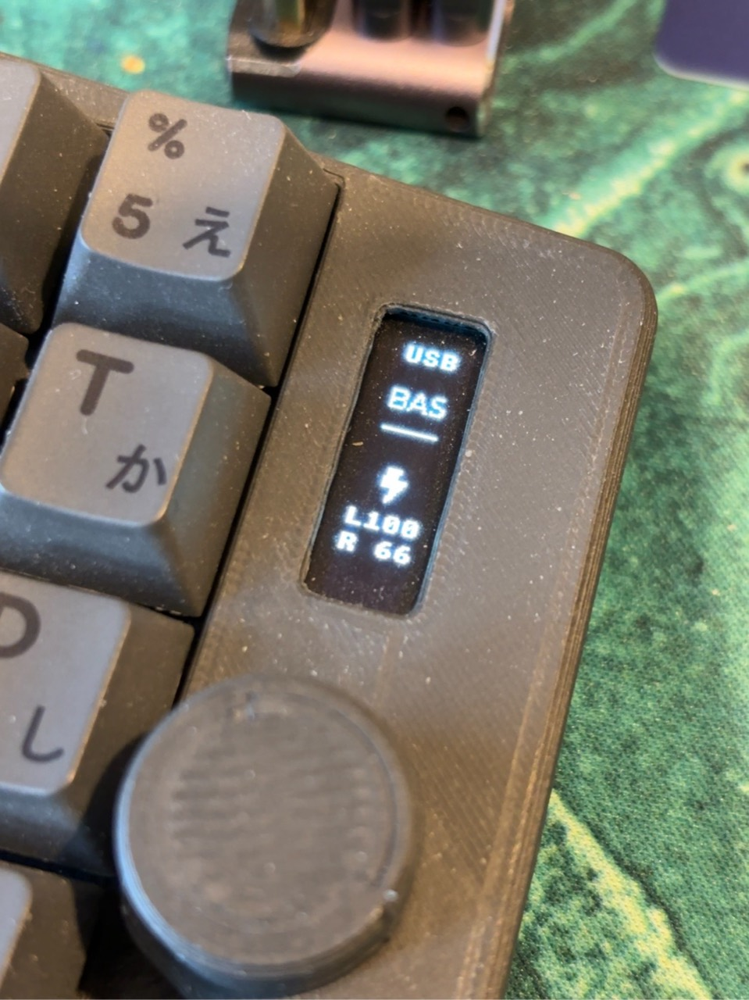

# Takmak OLED v0.1.0

[Скачать UF2](https://github.com/seniorsoftwarevlogger/takmak/releases/download/oled-v0.1.0/takmak-oled-left-central-v0.1.0.uf2) · [Релиз и SHA-256](https://github.com/seniorsoftwarevlogger/takmak/releases/tag/oled-v0.1.0) · [English](oled.en.md)

Обновление **ведущей левой половинки** Takmak с контроллером SuperMini
nRF52840 / nice!nano v2 и OLED SSD1306 0,91″, 128×32, I²C.
Левая половинка подключается к компьютеру по USB/BLE, правая работает как
BLE-периферия. Это не прошивка для отдельного донгла или большого TFT.
Опубликованный UF2 обновляет только левую половинку: существующую совместимую
прошивку правой оставьте на месте. Для первоначальной сборки обеих половинок
используйте [исходники и build matrix](../../firmware/zmk-keyboard-takmak).

## Что изменилось

- Вертикальная компоновка 32×128: подключение, слой, молния и заряд обеих половинок.
- Строки `L100` / `R 67` вместо WPM и знаков процента; расстояние между строками 12 пикселей.
- `R --` до получения данных и при потере связи. Настоящий нулевой заряд — `R  0`.
- После переподключения ожидается свежее показание батареи.
- ZMK Studio и прежняя раскладка сохранены. Переподключение BLE этим релизом не меняется.

Молния — обозначение блока батарей, не индикатор фактического зарядного тока.



## Обновление

1. Скачайте `takmak-oled-left-central-v0.1.0.uf2` из релиза.
2. Подключите **левую** половинку кабелем USB с передачей данных.
3. Дважды быстро нажмите Reset: появится диск `NICENANO`.
4. Скопируйте UF2 на этот диск. После записи контроллер перезагрузится.
5. Проверьте вертикальный экран, ввод с обеих половинок и заряд L/R.

Для обычного обновления прошивка `settings_reset` не нужна. Если правая
половинка не подключилась, сначала однократно перезапустите обе половинки;
сброс привязок не является частью этого обновления.

## Проверка и воспроизводимость

Версия прошита и подтверждена автором на клавиатуре 4 ноября 2026 года:
правильная ориентация, USB, слой и показания L/R. Отрисовка, поворот всех 4096
пикселей, обновление отдельных областей и обработка потери связи проверены
host-тестами с настоящими LVGL, кодом монохромного драйвера Zephyr и ASan/UBSan.
Повторная физическая проверка сценария потери/восстановления связи отдельно
не подтверждена.

SHA-256 UF2:

```text
a8d8899c9b5205647a85baefde905de175f598161424d74e7d0d5000d187b868
```

[Манифест релиза](../../firmware/releases/oled-v0.1.0.json) фиксирует зависимости,
контрольные суммы скомпилированных исходников и параметры сборки.
[Команда сборки](../../firmware/zmk-keyboard-takmak/README.md) использует локальный
модуль из этого репозитория. FLASH: 357484 байта; RAM: 82450 байт.
